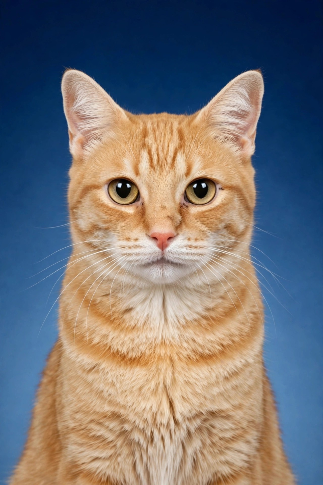

Guadalupe Street News Agency, Austin, October 31

> Author: [Koutian Wu](https://www.linkedin.com/in/ktwu01/); [GitHub: ktwu01](https://github.com/ktwu01/)

Résumé of Ms. Pumpkin Patch

　　Pumpkin Patch, female, orange tabby, born October 2023, a cat of Austin, Texas. Joined the household in October 2026. Education unknown. Believed to be illiterate; recognizes only lickable cat treats.

　　Previously served as kennel observer and adoption candidate at the Austin Animal Center. Kept a low profile in office, holding her corner without contention. In October 2026, in an assessment with several competing candidate cats, she stood out for her cooperation at mealtime, her habit of rubbing against people unprompted, and her record of scratching only the scratching post and never the furniture. She was hired the same day, becoming the household's first and only cat on the permanent staff.

　　Currently serves as Head of the Austin Leading Group on Human-Pet Cohabitation and Chair of the Oversight Committee for the Syrian hamster "Artificial Super Intelligence" (ASI), exercising vertical management over the household's Senior Litter Officer. Weight five pounds fourteen ounces. In good health, spayed, fully vaccinated against rabies, microchipped and registered; chip number withheld in accordance with the law.

Responsible editor: Senior Litter Officer
